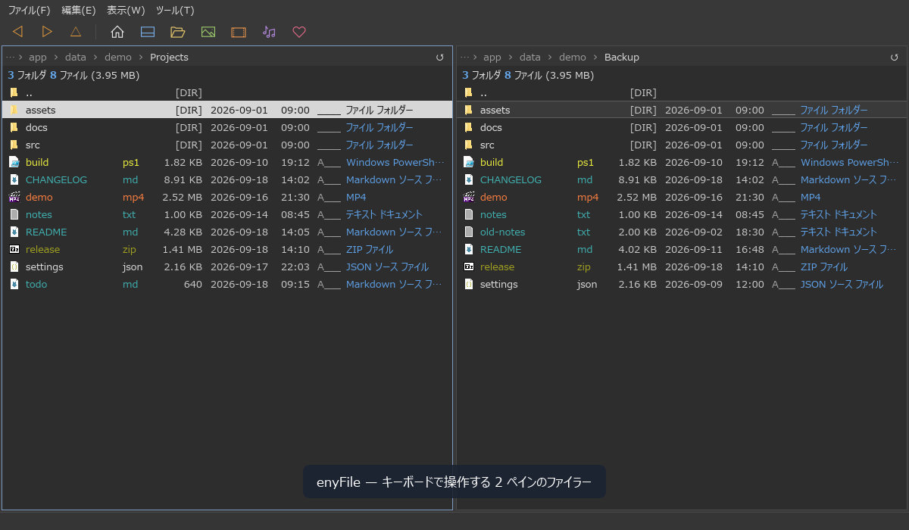

# enyFile

[](https://github.com/Eniwder/enyFile/actions/workflows/ci.yml)
[](https://github.com/Eniwder/enyFile/releases/latest)

Windows 専用の、キーボード中心の 2 ペインファイラー。Rust + [Slint](https://slint.dev/) 製。



## ダウンロード/インストール

[Releases](https://github.com/Eniwder/enyFile/releases/latest) から `enyFile-vX.Y.Z-windows-x64.zip` をダウンロードして展開し、`enyfile.exe` を実行します。インストーラーはありません。

## 特徴

- 2 / 3 / 4 ペイン
- スタイリッシュなデザイン
  - 配色・フォント・ブックマークなどのカスタマイズ
- 高速な動作
- AIエージェント連携（現在はCodex CLIのみ対応。サンドボックス内で実行）

## 動作環境

- Windows 10 / 11（x64）

設定は `enyfile.exe` と同じフォルダーの `config.json` に保存されます（ポータブル）。フォルダーごと移動・コピーすれば設定も一緒に移ります。`Program Files` など書き込めない場所に置くと設定を保存できないので、書き込める場所に展開してください。

新しいバージョンに更新するときは、`enyfile.exe` だけを差し替えれば設定はそのまま残ります。zip を丸ごと上書きで展開すると、エージェントのメモリ（`agentmemory.md`）が初期内容に戻るので注意してください。

`enyfile.exe` にはコード署名がないため、初回の起動時に Windows SmartScreen の「Windows によって PC が保護されました」が出ることがあります。その場合は「詳細情報」→「実行」で起動できます。

`config.json` が壊れていて読めないときは、`config.json.broken-日時` に退避して既定の設定で起動します。異常終了したときは、同じフォルダーの `crash.log` に記録が残ります（不具合の報告に添えてください）。

## 基本操作

| キー | 動作 |
| --- | --- |
| Ctrl+C / Ctrl+X / Ctrl+V | コピー / 切り取り / 貼り付け |
| Delete / Shift+Delete | ごみ箱へ / 完全削除 |
| Enter / Backspace | 開く / 親フォルダーへ |
| Tab | ペインの切り替え |
| F2 | リネーム |
| Ctrl+F / Ctrl+G | 検索 / 次を検索（`*` `?` 可） |
| Ctrl+Shift+F / Esc | フィルター / 解除 |
| Ctrl+Alt+Shift+F | フォルダー以下を検索（入力しながら絞り込み、Esc で戻る） |
| Ctrl+Shift+D | 2 つのペインを比較（もう一度で差分のみ、3 回目か Esc で終了） |
| Ctrl+I | エージェントに文章で依頼（もう一度か Esc で閉じる。下の「エージェント」） |

並べ替え、ペイン数の切り替え、設定画面など、そのほかの操作と画面の説明は [app/README.md](app/README.md) を参照してください。

## エージェント（Codex CLI 連携）

手作業では面倒なファイル操作を、文章で頼めます（例:「選択した画像を 256×256 に縮小して」「この写真を撮影日のフォルダーに分けて」）。enyFile は [Codex CLI](https://github.com/openai/codex) を呼び出すだけで、考えてコマンドを実行するのは Codex です。API キーなどの設定は enyFile にはありません。

1. Codex CLI をインストールしてサインインしておく（`npm install -g @openai/codex` → `codex login`）。PATH に無いときは ファイル > 設定 > エージェント で `codex.exe` の場所を指定する（VS Code の ChatGPT 拡張に同梱の Codex も自動で見つけます）
2. **Ctrl+I**（または最下部の履歴行をダブルクリック）でパネルを開き、依頼を入力して Enter
3. アクティブなペインのフォルダーで実行し、選択中の項目（未選択ならカーソル行）のパスも渡します。↑ ↓ で前に送った依頼を呼び出せます。終わると一覧を更新します。続けて入力すると同じ会話の続きになり、「新しい会話」（Ctrl+N）で最初からやり直せます

確認なしで自動実行するので、書き込める範囲を ファイル > 設定 > エージェント で選び、Codex のサンドボックスで制限します。

| モード | 書き込める場所 |
| --- | --- |
| A. 表示中のフォルダーのみ（既定・推奨） | アクティブなペインのフォルダー以下 |
| B. 追加のフォルダーも許可 | A と、設定で登録したフォルダー以下（画像・動画の整理先など） |
| C. 制限なし（危険） | どこでも（サンドボックスなし） |

- どのモードでも読み取りはフォルダーの外にも及びます。A・B の制限の強さは Codex のサンドボックスに依存し、ネットワークにも接続できません（ダウンロードやツールのインストールを含む依頼は失敗します）
- 範囲の外への書き込みは失敗するだけで、権限を広げる確認は出しません
- 設定ファイルの隣の `agent\memory.md` が専用メモリです（配布 zip に最初から入っていて、無ければ起動時に作ります）。enyFile から起動したときだけ読み込まれ、「覚えて」「今後はこうして」と頼んだときだけエージェントが書き換えます（メモリのフォルダーにはどのモードでも書き込めます）。設定画面の「開く」で直接編集もできます。初期内容は「削除はごみ箱経由」「作業フォルダーがドライブのルートなど広すぎるときは変更の前に確認」で、好みに書き換えられます。メモリに書いたパスは書き込みの権限を広げません

## ソースからビルド

[Rust](https://rustup.rs/)（stable, MSVC ツールチェーン）と Visual Studio Build Tools が必要です。

```powershell
git clone https://github.com/Eniwder/enyFile.git
cd enyFile
cargo build --release --manifest-path app/Cargo.toml
.\enyFile.cmd    # app\target\release\enyfile.exe を起動
```

`app\target` から起動した開発ビルドは、設定を `app\data\config.json` に保存し、起動フォルダー未設定時は試験用の `app\data\sandbox` を開きます（実ファイルを触らないため）。

テスト:

```powershell
cargo test --release --manifest-path app/Cargo.toml   # 単体テスト
.\app\Check.ps1                                       # ビルド＋単体テスト＋Explorer 連携スモーク（クリップボードを書き換えます）
```

README のアニメーション（`docs/demo.webp`）は `.\app\Demo.ps1` で作り直せます（ffmpeg が必要）。決まった内容の試験フォルダーを毎回作り、`app/src/demo.rs` の台本どおりにキーを送って 1 場面ずつ撮るので、何度作っても同じ映像になります。機能を足したら台本に場面を加えて実行し直してください。録画中の約 1 分はウィンドウに触れないでください。

## リリース

`app/Cargo.toml` の `version` を上げ、`Cargo.lock` も一緒にコミットしてから、そのコミットに同じ番号のタグを付けて push すると、GitHub Actions がビルドして Release を作成します。

```powershell
# app/Cargo.toml の version を 0.1.1 に変更してから
cargo update -p enyfile --manifest-path app/Cargo.toml   # Cargo.lock のバージョンを合わせる
git commit -am "v0.1.1"
git push
git tag v0.1.1      # バージョンを上げたコミットに付ける
git push origin v0.1.1
```

| ワークフロー | タイミング | 内容 |
| --- | --- | --- |
| [CI](.github/workflows/ci.yml) | main への push / PR | ビルドと単体テスト |
| [Release](.github/workflows/release.yml) | `v*` タグの push | バージョン照合・テスト・ビルド後、zip を Release に添付 |

## 構成

```text
app/
├── Cargo.toml
├── Check.ps1           ビルド＋テスト＋スモーク
├── Demo.ps1            README のアニメーションを録画（docs/demo.webp）
└── src/
    ├── main.rs         UI スレッドの制御、ペインごとの一覧ワーカー
    ├── ui.slint        画面・ダイアログ・テーマ
    ├── rows.rs         ペインの一覧のモデル（".."・項目・ドライブ、ページ送り）
    ├── settings.rs     設定ダイアログ・配色・ブックマーク・設定の保存
    ├── listing.rs      列挙・自然順ソート・選択モデル
    ├── paste.rs        貼り付けの計画（衝突の質問、再帰結合、別名）
    ├── pathid.rs       パスの同一性の判定（ファイル ID、リンクを辿る）
    ├── finder.rs       フォルダー以下の検索
    ├── compare.rs      ペインの比較
    ├── shell.rs        クリップボード、IFileOperation、フォルダー監視
    ├── ctxmenu.rs      シェルのコンテキストメニュー
    ├── icons.rs        関連付けアイコン
    ├── config.rs       設定ファイル
    ├── theme.rs        配色
    ├── smoke.rs        自動スモークテスト
    ├── demo.rs         README のアニメーションの台本と録画（--demo）
    └── bin/shellprobe.rs  スモーク用の Explorer 役
```

## Pull Request について

- **バグ修正**：歓迎します。
- **機能追加・機能改善**：作者の好みに合うものだけを受け入れます。せっかく作っていただいても見送ることがあるので、大きな変更の前には Issue で相談してもらえると助かります。

## NexusFile へのリスペクト

enyFile は、長く愛用してきたファイラー **NexusFile** をリスペクトして作っています。画面構成や操作感は NexusFile を強く参考にしています。

enyFile は NexusFile とは無関係の個人プロジェクトで、NexusFile のコードや画像などは使っていません。enyFile についての質問や不具合報告は、NexusFile の作者ではなく、このリポジトリの [Issues](https://github.com/Eniwder/enyFile/issues) または [@Eniel120](https://x.com/Eniel120) へお願いします。

## ライセンス

自作のソースコードは [MIT License](LICENSE) です。

ただし UI ツールキットの Slint を GPLv3 で利用しているため、ビルドしたアプリケーション（Release の配布物を含む）は **GPL-3.0-only** の条件で配布します（全文は [COPYING](COPYING)、`app/Cargo.toml` の `license` も同じ）。各 Release に対応するソースコードは、同じ名前のタグで入手できます。第三者の依存ライブラリはそれぞれのライセンスに従います。
